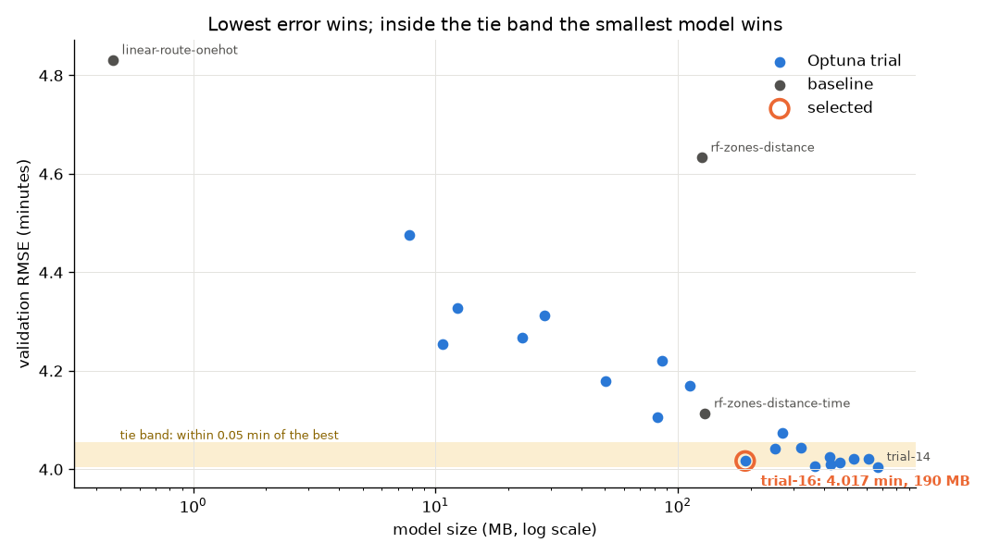
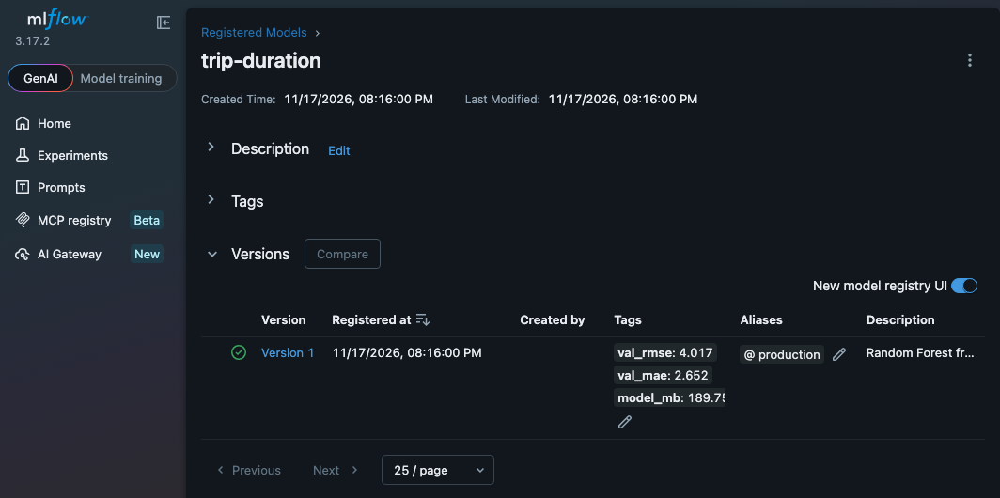
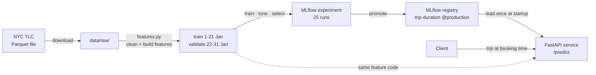

# End-to-End ML Microservice

[](https://github.com/sean-mas/end-to-end-ml-microservice/actions/workflows/ci.yml)

From a raw public dataset to a deployed prediction service, with every step tracked, tested and reproducible. The project downloads 3.5 million New York taxi trips, cleans them, compares 25 model runs in MLflow, promotes the winner in the MLflow model registry, and serves it from a FastAPI microservice in Docker. The service answers one question: **how long will this taxi trip take?**

**Result:** the served model predicts trip duration with an average error of **4.02 minutes** (RMSE; median miss 1.75 minutes, 86% of trips within ±5 minutes) on ten days it never saw. That is 58% better than guessing the average and 17% better than the course's reference model. The winner was picked by a rule written down before tuning: it is 0.7 seconds less accurate than the most accurate run, at 3.5× smaller size.

[Context](#context) · [Results](#results) · [Quick start](#quick-start) · [How it works](#how-it-works) · [API](#api) · [Decisions](docs/decisions.md) · [Tests](#tests-and-checks) · [Limitations](#limitations) · [Review questions](#review-questions)

## Context

- **What it is:** the final project of the model deployment module in the Machine Learning Engineering course by Spiced Academy (neuefische), built in November 2026.
- **The brief** ([docs/course-brief.md](docs/course-brief.md)): train a `RandomForestRegressor` on the January 2025 NYC Yellow Taxi trips to predict trip duration, track experiments locally with MLflow, serve predictions with FastAPI, and send a test request. Stretch goals: tests, and hyperparameter tuning compared against the baseline.
- **What I added:**
  - a date-based validation split (the service predicts future trips);
  - a ladder of four baselines;
  - a model-selection rule fixed before tuning;
  - promotion through the MLflow model registry;
  - an API that reports which model version answered;
  - behaviour tests on the real model;
  - Docker Compose for MLflow and the API;
  - CI that builds and starts the containers.
- **How it was built:** with [Claude Code](https://claude.com/claude-code) as an AI pair programmer. Every choice and trade-off is in [docs/decisions.md](docs/decisions.md) (18 decisions, each with what was not picked).

## Results

### Each idea, and what it was worth

| Run | Validation RMSE (min) | Model size | What it adds |
|---|---:|---:|---|
| Always guess the average | 9.65 | – | The bar any model must clear |
| Linear regression, one-hot route + distance | 4.83 | 0.5 MB | The course's reference model |
| Random Forest, zones + distance | 4.63 | 125 MB | A model that can learn non-linear patterns |
| + pickup hour and weekday | 4.11 | 129 MB | Rush hour: the biggest single gain |
| Best of 20 Optuna trials | 4.005 | 667 MB | Tuning |
| **Selected and served (trial-16)** | **4.017** | **190 MB** | Smallest model within 3 seconds of the best |

Validation is 22 to 31 January (1,167,015 trips); training is 1 to 21 January (2,158,857 trips).

### The selection rule

The lowest validation RMSE wins, but runs within 0.05 minutes (3 seconds) of the best count as tied, and the smallest of them wins. Ten runs tied. A rider can't notice 0.7 seconds, but a model a third the size loads faster and uses less memory in the container.



`uv run trip-duration select` draws this chart and logs it with the winning run in MLflow. The winner is then registered and marked `production`:



### How good is the served model?

| Check (validation days) | Result |
|---|---|
| Variation explained (R²) | 0.83 |
| Median miss | 1.75 min |
| Trips within ±5 minutes | 86% |
| Gap between training and validation error | 0.26 min (little overfitting) |
| Error per day | 3.54 to 4.21 min (stable) |
| Prediction time | 14 ms for one trip |

Where it is weaker:
- **Long trips:** it underestimates trips of 45 to 60 minutes by about 11 minutes.
- **Airport trips:** it misses them by 4.7 minutes on average, against 2.5 minutes for other trips.
- **Late January:** it predicts 0.5 minutes too short on average, because the validation days were about 6% slower than the training days. A random split would have hidden this.

See [Limitations](#limitations).

**Was tuning worth it?** Barely. 20 Optuna trials cut the error from 4.11 to 4.02 minutes (about 6 seconds per trip) and made the model 47% larger. The features, not the settings, did the heavy lifting.

## Quick start

You need [uv](https://docs.astral.sh/uv/) 0.13.5 or newer and [Docker Desktop](https://www.docker.com/products/docker-desktop/), running. No configuration file is needed.

**1. Start MLflow** and install the project:

```bash
uv sync
docker compose up -d --wait mlflow
```

MLflow is now at http://127.0.0.1:5001. It runs on port 5001 because macOS uses 5000 for AirPlay.

**2. Run every stage** (download, four baselines, 20 tuning trials, selection, promotion). It takes about 10 minutes on a laptop:

```bash
uv run trip-duration all
```

The run is reproducible: a fresh clone gives the same 25 runs and the same winner. Near the end you should see (after a timestamp):

```text
Winner: trial-16 (val_rmse=4.017, 190 MB). Best RMSE overall: 4.005. 10 runs tied.
Version 1 is now @production
```

The stages also run one at a time: `trip-duration download`, `train`, `tune`, `select`, `promote`.

**3. Start the API** and ask it about a trip:

```bash
docker compose up -d --wait api
curl -X POST http://127.0.0.1:8000/predict -H "Content-Type: application/json" -d @sample-request.json
```

```json
{"predicted_duration_minutes":17.03,"model_name":"trip-duration","model_version":"1"}
```

The interactive API docs are at http://127.0.0.1:8000/docs. Stop everything with `docker compose down`. The MLflow data stays in `./mlflow`.

## How it works



| Step | Command | Code | What it does |
|---|---|---|---|
| Download | `trip-duration download` | [data.py](src/trip_duration/data.py) | Saves January 2025 (59 MB) to `data/raw/` once |
| Clean and split | (part of every stage) | [features.py](src/trip_duration/features.py) | Keeps plausible trips, adds hour and weekday, splits by date |
| Baselines | `trip-duration train` | [train.py](src/trip_duration/train.py) | Four runs, each adding one idea |
| Tuning | `trip-duration tune` | [tune.py](src/trip_duration/tune.py) | 20 Optuna trials as child runs in MLflow |
| Selection | `trip-duration select` | [selection.py](src/trip_duration/selection.py) | Applies the rule, retrains and saves the winner |
| Promotion | `trip-duration promote` | [promote.py](src/trip_duration/promote.py) | Registers the winner, sets `@production` |
| Serving | `docker compose up api` | [app/](app/) | Loads `@production`, validates requests, predicts |

Every run logs the same scores (`val_rmse`, `val_mae`, `train_rmse`, `fit_seconds`, `model_mb`). Saved models also get a predicted-vs-actual plot. The API builds its features with the same `build_features` function as training, so training and serving can't drift apart.

### What the data needed

The exploration is in [notebooks/01-explore.ipynb](notebooks/01-explore.ipynb).

| Finding | Rule |
|---|---|
| 97.9% of trips last 1 to 60 minutes; the rest include negative durations and multi-day meters | Keep 1 to 60 minutes |
| 2.6% of trips have zero distance, and 162 claim over 100 miles | Keep 0.1 to 100 miles |
| Fare, tip and total are only known after the trip | Never used as features |
| Median speed falls from 16 mph at 05:00 to about 8.5 mph from 11:00 to 18:00 | Add pickup hour and weekday |
| The service predicts trips that haven't happened yet | Validate on later days, not a random sample |

After cleaning, 3,325,872 of 3,475,226 trips remain (95.7%).


## API

| Route | Input | Output |
|---|---|---|
| `GET /health` | – | Whether a model is loaded and which version; 503 with the reason if not |
| `POST /predict` | One trip | Predicted minutes and model version |
| `POST /predict_batch` | Up to 1,000 trips | One prediction per trip, in request order |

A trip is what a booking app knows before the ride starts:

```json
{
  "PULocationID": 161,
  "DOLocationID": 236,
  "trip_distance": 2.4,
  "pickup_datetime": "2025-01-23T17:30:00"
}
```

Zones are NYC TLC taxi zone IDs (161 is Midtown Center, 236 is Upper East Side North). The API rejects zones outside 1 to 265 and distances outside 0.1 to 100 miles with a 422, because the model never saw such trips. The same trip on Sunday at 05:30 gives 10.5 minutes instead of 17.0.

## Tests and checks

| Check | Command | What it covers |
|---|---|---|
| Unit and API tests (61) | `uv run pytest` | Every cleaning bound, the date split, the selection rule, the download, the CLI, and every API route with a fake model |
| Behaviour tests (5) | `uv run pytest -m integration` | The real production model: longer trips take longer, rush hour is slower than Sunday morning, the minute of pickup doesn't matter, predictions stay in range, the API matches the model |
| Lint and format | `uv run ruff check . && uv run ruff format --check .` | Style and import order |
| CI | GitHub Actions on every pull request | Lint, tests, and a Docker job that builds the image, starts both services, and checks the API reports 503 (not a crash) when the registry is empty |

The behaviour tests need the MLflow container with a promoted model, so CI skips them.

## Limitations

- **The distance is the one actually driven.** At booking time only a planned distance exists. A routing app's estimate would differ, so the real-world error will be higher than 4.02 minutes.
- **Long and airport trips** are weaker spots (see [How good is the served model](#how-good-is-the-served-model)). The model pulls extreme trips towards the middle.
- **One month of data.** January has holidays and winter weather. The model has not been checked on another month.
- **190 MB per model.** A Random Forest is large for a microservice. The course's linear model is 0.5 MB and only 0.8 minutes worse.
- **Local only.** MLflow has no login and both ports are bound to this machine. Nothing here is hardened for the internet.

## Project structure

```text
├── src/trip_duration/   config · data · features · models · tracking · train · tune · selection · promote · cli
├── app/                 main.py (routes) · model.py (load once) · schemas.py (request checks)
├── tests/               unit, API, CLI and behaviour tests
├── notebooks/           01-explore.ipynb: why each cleaning rule exists
├── docs/                decisions.md · course-brief.md · images/
├── Dockerfile           one image for MLflow and the API
├── docker-compose.yaml  mlflow (:5001) and api (:8000)
├── sample-request.json  the trip used in the Quick start
├── data/raw/            downloaded data (not in git)
└── mlflow/              MLflow database and model files (not in git)
```

## Review questions

**1. What is the RMSE of your final model?**
**4.017 minutes** on the validation days (22 to 31 January 2025, 1,167,015 trips). MAE is 2.65 minutes and R² is 0.83. The model is `trip-duration` version 1 in the MLflow registry: a Random Forest with 30 trees, depth up to 23, at least 20 trips per leaf, and 53% of features tried per split.

**2. What would you do differently if you had more time?**
1. **Train on the distance a booking app knows.** Replace the driven distance with a routing estimate, or with the typical distance between the two zones. That gives an honest error figure.
2. **Try gradient boosting** (`HistGradientBoostingRegressor`). It is usually more accurate than a Random Forest at a fraction of the size.
3. **Watch for drift and retrain.** The late-January slowdown already shows up as a 0.5-minute bias. A scheduled job (Prefect) could score each new month and retrain when the error rises.
4. **Fix the long-trip bias.** Try an airport flag, or predict the log of the duration.
5. **Check the model on February**, a month with different weather and no holidays.
