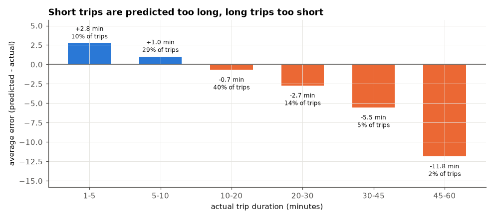
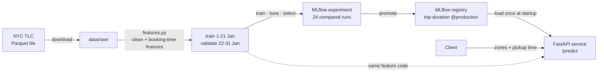
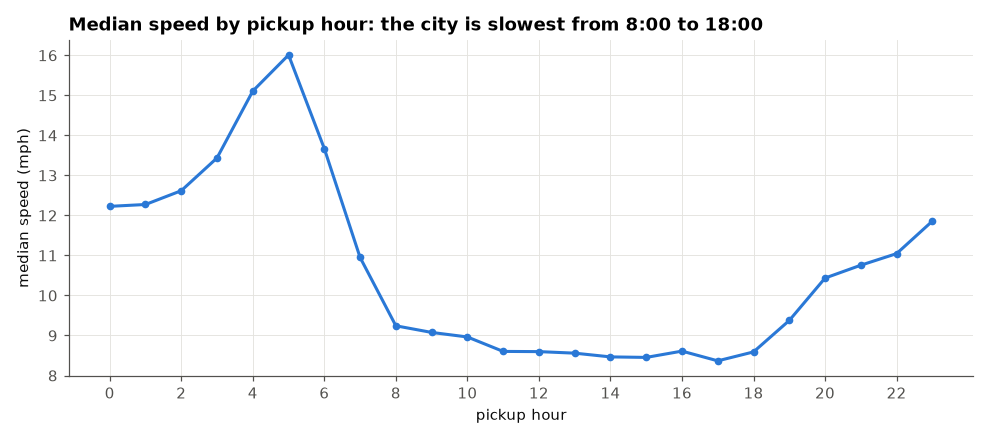
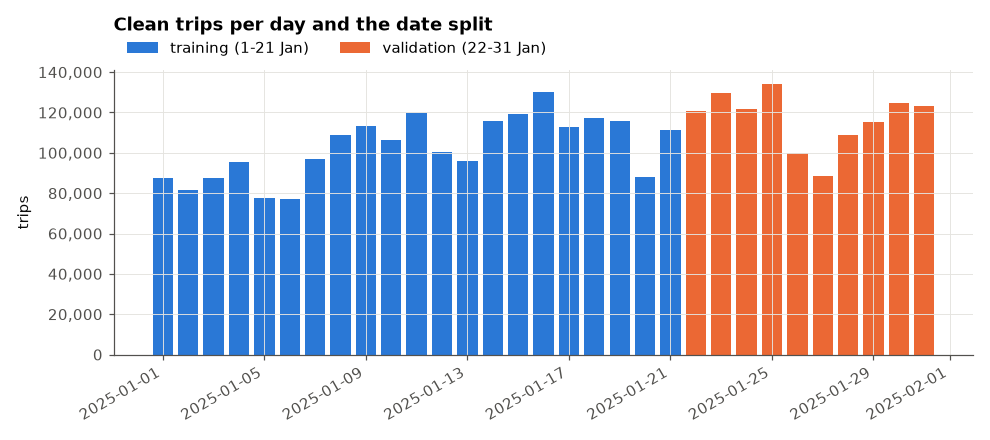

# End-to-End ML Microservice

[](https://github.com/sean-mas/end-to-end-ml-microservice/actions/workflows/ci.yml)

From a raw public dataset to a deployed prediction service, with every step tracked, tested and reproducible. The project downloads 3.5 million New York taxi trips, cleans them, compares 24 model runs in MLflow, promotes the winner in the MLflow model registry, and serves it from a FastAPI microservice in Docker. The service answers one question: **how long will this taxi trip take?**

**Result:** using only what is known when a trip is booked (pickup zone, dropoff zone and pickup time), the served model predicts trip duration with an error of **4.62 minutes** (RMSE) on ten days it never saw. Half of all trips are predicted within 2.3 minutes. That beats guessing the average by 52%.

[Context](#context) · [Results](#results) · [Quick start](#quick-start) · [How it works](#how-it-works) · [API](#api) · [Decisions](docs/decisions.md) · [Tests](#tests-and-checks) · [Limitations](#limitations) · [Review questions](#review-questions) · [Presentation](docs/presentation.pdf)

## Context

- **What it is:** the final project of the model deployment module in the Machine Learning Engineering course by Spiced Academy (neuefische), built in November 2026.
- **The brief** ([docs/course-brief.md](docs/course-brief.md)): train a `RandomForestRegressor` on the January 2025 NYC Yellow Taxi trips to predict trip duration, track experiments locally with MLflow, serve predictions with FastAPI, and send a test request. Stretch goals: tests, and hyperparameter tuning compared against the baseline.
- **What I added:**
  - only features known at booking time. The course's distance feature is the distance actually driven, which leaks the answer. I replaced it and retired the model that used it (see [Catching a leak](#catching-a-leak-version-1-to-version-2));
  - a date-based validation split (the service predicts future trips);
  - a ladder of four baselines;
  - a model-selection rule set before tuning ran;
  - promotion through the MLflow model registry;
  - an API that reports which model version answered;
  - a detailed evaluation of the served model, including where it fails;
  - behaviour tests on the real model;
  - Docker Compose for MLflow and the API, and CI that builds and starts the containers.
- **How it was built:** with [Claude Code](https://claude.com/claude-code) as an AI pair programmer. Every choice and trade-off is in [docs/decisions.md](docs/decisions.md) (19 decisions, each with what was not picked).

## Results

### Each idea, and what it was worth

| Run | Validation RMSE (min) | Model size | What it adds |
|---|---:|---:|---|
| Always guess the average | 9.65 | – | The bar any model must clear |
| Linear regression, one-hot route + typical distance | 5.16 | 0.9 MB | The course's reference model |
| Random Forest, zones + typical distance | 5.18 | 29 MB | A forest alone is no better than the linear model |
| + pickup hour and weekday | 4.68 | 121 MB | Rush hour: the biggest gain after the first step |
| Best of 20 Optuna trials | 4.610 | 575 MB | Tuning |
| **Selected and served (trial-16)** | **4.619** | **159 MB** | Smallest model within 3 seconds of the best |

Validation is 22 to 31 January (1,167,015 trips); training is 1 to 21 January (2,158,857 trips). The comparison holds 24 runs: 4 baselines and 20 tuning trials. "Typical distance" is the median distance between the two zones in the training trips.

### The selection rule

Set before the tuning ran: the lowest validation RMSE wins, but runs within 0.05 minutes (3 seconds) of the best count as tied, and the smallest of them wins. Eleven runs tied. The served model is half a second less accurate than the best run, at 3.6× smaller size.


`uv run trip-duration select` draws this chart and logs it with the winning run in MLflow. The winner is then registered and marked `production`.

### Catching a leak: version 1 to version 2

The first model, version 1, used the trip's recorded `trip_distance`, as the course's reference solution does. That is the distance **actually driven**, known only after the trip ends, so a booking app can't send it. Version 1 scored 4.02 minutes, but that score was optimistic.

Version 2 replaces it with the **typical distance between the two zones**, learned from the training trips only. The typical distance is within 0.27 miles of the driven one for half of all trips (correlation 0.96), and 99.6% of validation trips run between zones already seen in training. The honest cost is 0.6 minutes of RMSE (4.02 to 4.62). Version 1 stays in the registry, marked retired, with the reason:


### How good is the served model?

From [notebooks/02-evaluate.ipynb](notebooks/02-evaluate.ipynb), or `uv run trip-duration evaluate`:

| Check (validation days) | Result |
|---|---|
| Variation explained (R²) | 0.77 |
| Median miss | 2.3 min |
| Trips within ±5 minutes | 82% |
| Gap between training and validation error | 0.33 min (little overfitting) |
| Error per day | 4.15 to 4.79 min (stable) |
| Prediction time | under 20 ms for one trip (on a laptop) |

Where it is weaker:
- **Very short and long trips:** it pulls extreme trips towards the middle. Trips under 5 minutes come out almost 3 minutes too long, and trips of 45 to 60 minutes about 12 minutes too short.
- **Airport trips:** it misses them by 4.8 minutes on average, against 3.0 minutes for other trips.
- **Late January:** it predicts 0.55 minutes too short on average, because the validation days were about 6% slower than the training days. A random split would have hidden this.



**Was tuning worth it?** Barely. 20 Optuna trials cut the error from 4.68 to 4.62 minutes (about 4 seconds per trip) and made the model 32% larger. The features, not the settings, did the heavy lifting.

## Quick start

You need [uv](https://docs.astral.sh/uv/) 0.13.5 or newer and [Docker Desktop](https://www.docker.com/products/docker-desktop/), running. No configuration file is needed.

**1. Start MLflow** and install the project:

```bash
uv sync
docker compose up -d --wait mlflow
```

MLflow is now at http://127.0.0.1:5001. It runs on port 5001 because macOS uses 5000 for AirPlay.

**2. Run every stage** (download, four baselines, 20 tuning trials, selection, promotion). It takes about 15 minutes on a laptop:

```bash
uv run trip-duration all
```

The run is reproducible: a clean copy gives the same 24 runs and the same winner. Near the end you should see (after a timestamp):

```text
Winner: trial-16 (val_rmse=4.619, 159 MB). Best RMSE overall: 4.610. 11 runs tied.
Version 1 is now @production
```

On a fresh clone the winner is version 1 of the registry. In this project's own registry it is version 2, because version 1 was the leaky model.

The stages also run one at a time: `trip-duration download`, `train`, `tune`, `select`, `promote`. Afterwards, `trip-duration evaluate` prints the detailed quality check.

**3. Start the API** and ask it about a trip:

```bash
docker compose up -d --wait api
curl -X POST http://127.0.0.1:8000/predict -H "Content-Type: application/json" -d @sample-request.json
```

```json
{"predicted_duration_minutes":13.75,"model_name":"trip-duration","model_version":"1"}
```

The interactive API docs are at http://127.0.0.1:8000/docs. Stop everything with `docker compose down`. The MLflow data stays in `./mlflow`.

Without Docker for the API, `uv run uvicorn app.main:app --port 8000` serves the same model from the MLflow container.

## How it works



| Step | Command | Code | What it does |
|---|---|---|---|
| Download | `trip-duration download` | [data.py](src/trip_duration/data.py) | Saves January 2025 (59 MB) to `data/raw/` once |
| Clean and split | (part of every stage) | [features.py](src/trip_duration/features.py) | Keeps plausible trips, adds hour and weekday, splits by date |
| Typical distance | (first step of every model) | [transformers.py](src/trip_duration/transformers.py) | Learns the median distance per zone pair from training trips, then drops the driven distance |
| Baselines | `trip-duration train` | [train.py](src/trip_duration/train.py) | Four runs, each adding one idea |
| Tuning | `trip-duration tune` | [tune.py](src/trip_duration/tune.py) | 20 Optuna trials as child runs in MLflow |
| Selection | `trip-duration select` | [selection.py](src/trip_duration/selection.py) | Applies the rule, retrains and saves the winner |
| Promotion | `trip-duration promote` | [promote.py](src/trip_duration/promote.py) | Registers the winner, sets `@production` |
| Evaluation | `trip-duration evaluate` | [evaluate.py](src/trip_duration/evaluate.py) | Error by trip length, by day, airport vs other trips |
| Serving | `docker compose up api` | [app/](app/) | Loads `@production`, validates requests, predicts |

Every run logs the same scores (`val_rmse`, `val_mae`, `train_rmse`, `fit_seconds`, `model_mb`). Saved models also get a predicted-vs-actual plot. The API builds its features with the same `build_features` function as training, so training and serving can't drift apart. The typical-distance lookup is part of the saved model, so the API needs no extra file.

### What the data needed

The exploration is in [notebooks/01-explore.ipynb](notebooks/01-explore.ipynb).

| Finding | Rule |
|---|---|
| 97.9% of trips last 1 to 60 minutes; the rest include negative durations and multi-day meters | Keep 1 to 60 minutes |
| 2.6% of trips have zero distance, and 162 claim over 100 miles | Keep 0.1 to 100 miles |
| Fare, tip and total are only known after the trip | Never used as features |
| The recorded distance is the distance driven, also only known after the trip | Use the typical distance between the two zones |
| Median speed falls from 16 mph at 05:00 to 8.4-9.2 mph between 08:00 and 18:00 | Add pickup hour and weekday |
| The service predicts trips that haven't happened yet | Validate on later days, not a random sample |

After cleaning, 3,325,872 of 3,475,226 trips remain (95.7%).





## API

| Route | Input | Output |
|---|---|---|
| `GET /health` | – | Whether a model is loaded and which version; 503 with the reason if not |
| `POST /predict` | One trip | Predicted minutes and model version |
| `POST /predict_batch` | Up to 1,000 trips | One prediction per trip, in request order |

A trip is what a booking app knows before the ride starts:

```json
{
  "PULocationID": 161,
  "DOLocationID": 236,
  "pickup_datetime": "2025-01-23T17:30:00"
}
```

Zones are NYC TLC taxi zone IDs (161 is Midtown Center, 236 is Upper East Side North, 132 is JFK Airport).

| Trip | Prediction |
|---|---:|
| Midtown → Upper East Side, Thursday 17:30 | 13.8 min |
| The same, Sunday 05:30 | 8.1 min |
| Midtown → JFK, Thursday 17:30 | 54.0 min |

The API rejects zones outside 1 to 265 with a 422, because the model never saw them. It also rejects unknown fields, so a client that still sends `trip_distance` learns that it is no longer an input instead of being silently ignored.

## Tests and checks

| Check | Command | What it covers |
|---|---|---|
| Unit, API and CLI tests (67) | `uv run pytest` | Every cleaning bound, the typical-distance lookup and its fallbacks, the date split, the selection rule, the evaluation figures, the download, the CLI, and every API route with a fake model |
| Behaviour tests (9) | `uv run pytest -m integration` | The real production model: farther destinations take longer, rush hour is slower than Sunday morning, the minute of pickup doesn't matter, predictions stay in range for five zone pairs, the API matches the model |
| Lint and format | `uv run ruff check . && uv run ruff format --check .` | Style and import order |
| CI | GitHub Actions on every pull request | Lint, tests, and a Docker job that builds the image, starts both services, and checks the API reports 503 (not a crash) when the registry is empty |

The behaviour tests need the MLflow container with a promoted model, so CI skips them (`uv run pytest` runs them too when MLflow is up).

## Limitations

- **The typical distance can't see the route.** Two trips between the same zones get the same distance, whether the driver takes the highway or detours. A routing app's estimate per trip would do better.
- **Very short, long and airport trips** are weaker spots (see [How good is the served model](#how-good-is-the-served-model)). The model pulls extreme trips towards the middle.
- **One month of data.** January has holidays and winter weather. The model has not been checked on another month.
- **159 MB per model.** A Random Forest is large for a microservice. The course's linear model is 0.9 MB and 0.54 minutes worse.
- **Local only.** MLflow has no login and both ports are bound to this machine. Nothing here is hardened for the internet.

## Project structure

```text
├── src/trip_duration/   config · data · features · transformers · models · tracking · train · tune · selection · promote · evaluate · cli
├── app/                 main.py (routes) · model.py (load once) · schemas.py (request checks)
├── tests/               unit, API, CLI, evaluation and behaviour tests
├── notebooks/           01-explore.ipynb (why each cleaning rule exists) · 02-evaluate.ipynb (where the model fails)
├── docs/                decisions.md · presentation.pdf · presentation-notes.md · course-brief.md · images/
├── Dockerfile           one image for MLflow and the API
├── docker-compose.yaml  mlflow (:5001) and api (:8000)
├── sample-request.json  the trip used in the Quick start
├── data/raw/            downloaded data (not in git)
└── mlflow/              MLflow database and model files (not in git)
```

## Review questions

**1. What is the RMSE of your final model?**
**4.619 minutes** on the validation days (22 to 31 January 2025, 1,167,015 trips), using only booking-time information. MAE is 3.16 minutes and R² is 0.77. The model is `trip-duration` version 2 in the MLflow registry: a Random Forest with 30 trees, depth up to 23, at least 20 trips per leaf, and 53% of features tried per split. Version 1, which used the driven distance, scored 4.017 but could not be used at booking time.

**2. What would you do differently if you had more time?**
1. **Use a routing estimate per trip** instead of the typical zone-to-zone distance, for example from an open routing engine. That recovers most of what the driven distance gave, without the leak.
2. **Try gradient boosting** (`HistGradientBoostingRegressor`). It is usually more accurate than a Random Forest at a fraction of the size.
3. **Watch for drift and retrain.** The late-January slowdown already shows up as a 0.55-minute bias. A scheduled job (Prefect) could score each new month and retrain when the error rises.
4. **Fix the bias at the extremes.** Try an airport flag, or predict the log of the duration.
5. **Check the model on February**, a month with different weather and no holidays.
